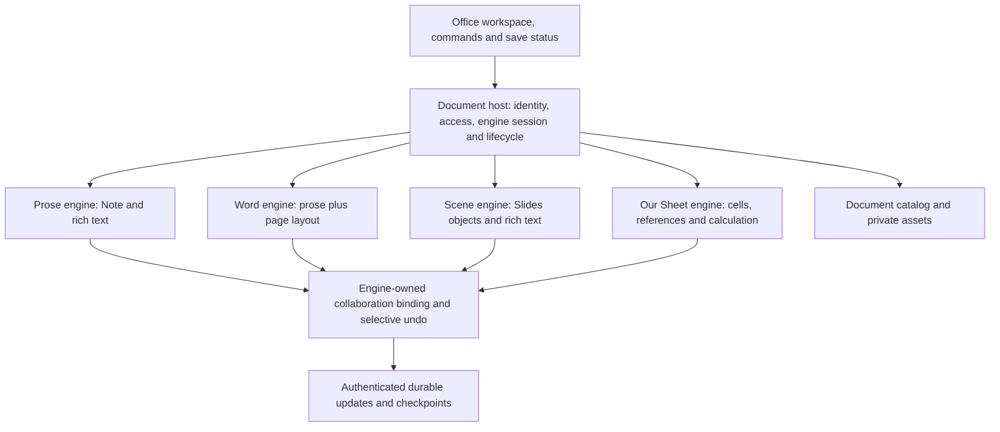

# Office suite v2: native Sheet engine and collaboration

This is a new design based on the current source and the human instructions of 2026-10-21. Historical roadmap entries and Issue completion records are not implementation evidence for this design. No implementation or runtime acceptance is claimed here. The current delivery sequence is in [the roadmap](../ROADMAP.md).

Tracking records: [suite #520](https://github.com/barocss/barocss-editor/issues/520), [M0 #521](https://github.com/barocss/barocss-editor/issues/521), [M0 milestone](https://github.com/barocss/barocss-editor/milestone/19). This source document remains local; those records publish the direction and first gate without claiming a code delivery.

## 1. Product and fixed decisions

Build one Office workspace containing Note, Word, Slides and Sheet. Preserve the existing Site product as a consumer of shared components; new Site features are outside the first suite delivery. Existing files and features remain available through their current versioned engines during migration.

The human explicitly selected an **in-house Sheet engine**. We own its workbook model, cell/range operations, formula parser and evaluator, reference semantics, dependency graph, recalculation, grid and collaboration binding. A third-party spreadsheet product SDK is not the implementation path. Low-level libraries for CRDT, ZIP/XML, Unicode or numeric utilities can be evaluated separately without transferring ownership of the Sheet engine.

The following decisions are fixed:

1. Share workspace, identity, access, assets and document lifecycle. Keep prose, paginated documents, scenes and workbooks as distinct domains.
2. Give each document one editable engine and one authoritative mutation protocol. Local pending replicas and durable server state are different stages of that protocol.
3. Design collaboration, selective undo, persistence and recovery with the domain operations. They are not a later snapshot synchronization feature.
4. Use DOM for the application shell and prose input. Use DOM/SVG for the initial Slides view. Build a virtualized Canvas2D Sheet view with a DOM input/accessibility layer. Keep Word layout results separate from both source content and rendering.
5. Preserve engine-native content. A workbook is not an array attribute on an `INode` document.
6. Treat Office file compatibility as a tested feature matrix. Never equate native JSON persistence with DOCX/XLSX/PPTX compatibility.
7. Preserve originals. Migration is an explicit copy to a new versioned document, not an overwrite of the existing file.

Yjs is the first low-level collaboration primitive to validate for our new bindings. This is not adoption of the current `collaboration-yjs` adapter. Final acceptance of the primitive and its document mappings requires M0 evidence. We will not build a new general-purpose CRDT algorithm as part of the initial Sheet engine.

## 2. Responsibility boundaries

The diagram shows shared contracts, not one universal operation implementation. A prose insertion, object move and row insertion retain their domain meanings. Existing product packages remain siblings; one product must not depend on another product's UI/runtime.

| Boundary | Owns | Does not own |
| --- | --- | --- |
| Office shell | Navigation, file tree, shared controls, truthful save/error state | Cells, paragraph positions, CRDT state |
| Document host | Current identity/access, document generation, engine lifecycle, version admission | A second editable content store |
| Domain engine | Typed content, commands, invariants, projection and native serialization | Account authentication or implicit grants |
| Collaboration binding | Domain-to-shared-type mapping, origins, stable positions, selective undo | Snapshot replacement as concurrent editing |
| Durable service | Authorized update acceptance, idempotent persistence, checkpoints, recovery | Browser-only success as a saved receipt |
| Catalog/asset service | Metadata, ACLs, private bytes, durable asset references | A second editable copy of collaborative content |
| File exchange | Bounded import/export and loss reports | Silent conversion or permission to mutate source files |

The conceptual document envelope contains tenant/workspace/document identity, product kind, engine ID/version, adapter version, schema/native format version, document generation, asset references and an engine-specific durable checkpoint descriptor. A CRDT frontier, a catalog revision and an export-file version are distinct fields. There is no assumed global integer revision for all concurrent edits.

## 3. Reuse, adapt, replace and build

Reuse means retain proven source behavior and run affected checks against its new consumer. It does not mean the current code already passes the new acceptance.

| Existing area | Disposition | Boundary in v2 |
| --- | --- | --- |
| `packages/schema` validation/content matching | Reuse and adapt | Keep prose validation; add engine-specific admission and typed boundaries. Do not force workbook cells into the Office node vocabulary. |
| `packages/model`, `packages/datastore` | Reuse for existing prose and isolated drafts | Existing local editing remains. Collaborative documents receive a controlled projection or adapter; direct writes cannot compete with the shared engine. Whole-store cloning is not the Sheet storage algorithm. |
| `packages/editor-core` command/selection facilities | Reuse selectively | Retain useful command lifecycle and local editor behavior. Sheet gets cell/range selection and native command semantics. |
| `editor-view-dom`, `renderer-dom`, `dsl` | Reuse | Note/rich-text DOM input and rendering. HTML templates are not treated as a renderer-independent display list. |
| `office-text`, `office-ui`, `office-editor-ui`, icons/controls | Reuse and adapt | Shared prose formatting and UI. Product semantics and model positions remain engine-owned. |
| `office-canvas`, Slides geometry | Reuse | Object identity, geometry and commands. These packages are not Canvas2D text/grid renderers. |
| Note/Word/Slides native codecs | Retain as legacy readers; versioned adapters | Preserve old files and native metadata. New formats do not silently replace old codecs. |
| `office-workspace`, Office shell | Adapt | Add native Sheet routing, engine capability discovery and common lifecycle. Preserve account/document retirement. |
| Office API/service access, asset, revision and recovery code | Reuse after contract checks; extend | Reuse current access and recovery boundaries. Add durable collaboration update/checkpoint storage and actual startup wiring. Snapshot CAS remains a legacy path. |
| Existing inverse HistoryManager | Keep for local legacy documents; replace in collaborative sessions | It does not rebase stored offsets/whole values over remote edits. Use engine-aware selective undo. |
| Existing Yjs/Liveblocks adapters | Exclude from the v2 correctness path | New granular bindings need their own evidence. Package presence is not collaborative editing support. |
| Existing limited Note Yorkie codec | Retain as isolated legacy code | Do not broaden its acceptance or silently mix it with the selected v2 binding. |
| Note database and `dataset-evaluation` | Keep for record/database features | Neither is the workbook model or Excel formula engine. |
| Current DOCX converter | Retain bounded behavior; adapt or replace specific exchange paths | Preserve loss reporting. New support requires corpus evidence. |
| Current Slides native JSON exchange | Retain | PPTX exchange is new work. |
| Sheet native model, operations and files | Build | Sparse cells, stable sheet/row/column identities, ordering, ranges, style references, native codec. |
| Sheet calculation | Build | Parser/AST, reference semantics, dependency graph, incremental calculation, error/date/number rules. |
| Sheet view and interaction | Build | Canvas2D viewport, frozen panes, hit testing, ranges, scrolling, input overlay, IME, clipboard, accessibility. |
| Shared collaboration contracts and domain bindings | Build | Granular changes, session origins, structural conflict policy, recovery, durable acknowledgments. |
| Word layout result and scalable print path | Rework | Explicit page/line/fragment-to-model mapping; measured font environment; avoid a full document clone per output page. |
| XLSX and PPTX exchange, expanded DOCX fidelity | Build or boundedly replace | Own adapters and compatibility manifests, using low-level format libraries if suitable. |

Source evidence for this split includes the current [node model](../../packages/datastore/src/types.ts), [transaction path](../../packages/model/src/transaction.ts), [database cell update](../../packages/office-note/src/database.ts), [formula evaluator](../../packages/schema/src/dataset-evaluation.ts), [Yjs mapping](../../packages/collaboration-yjs/src/yjs-adapter.ts), [Office collaborative-mode refusal](../../apps/office/src/auth-client.ts), [Word print path](../../packages/office-word/src/print-pages.ts) and [DOCX limits](../../packages/office-word/src/word-docx.ts). These are source findings, not new runtime passes.

## 4. Our Sheet engine

### 4.1 Content and identities

- A workbook contains stable sheet IDs, ordered row/column identities, sparse cell records and shared style definitions. Empty cells do not require materialized document nodes.
- A cell key identifies sheet/row/column identities. A displayed address such as `B3` is resolved through the current order. Storage identity and display position are distinct.
- A cell stores one versioned input record: a literal value, a canonical typed formula AST with its parsing context, or an explicit invalid/unsupported input. Formula display text is derived from that record and the current address mapping. Original import text is retained as provenance, not an independently editable second source. Formula results are derived caches, not a second authoritative input field.
- Multiple sheets, ranges, merges and named references belong to the workbook. Rich cell text is owned by that workbook; it is not a separately saved Note session.
- Draft text stays local until a deliberate cell commit. A formula/value commit is atomic. Same-cell concurrent commits follow causal ordering and a stable tie-breaker, with recoverable alternative history. Wall-clock time is not the sole ordering authority. Plain `Y.Map.set` does not provide the required alternative history; the binding must implement and test it. Arbitrary formula strings are not merged character by character.

### 4.2 References and structure

The parser resolves displayed A1 references into typed references. References retain row/column identities, absolute/relative copy behavior and the context needed for relocation. Stable IDs alone do not define all Excel semantics. `$A$1` prevents relative displacement during copy; it does not mean that inserting a row must keep the referenced target at display address A1.

The reference contract must distinguish copy/fill from cut/move, insertion from deletion, sorting from filtering, and address relocation from moving cell content. Range endpoints need explicit boundary-insertion behavior and interior membership rules. Deleted targets produce a defined `#REF!` result; later ID reuse must not revive them.

Rows/columns need deterministic ordering and a defined concurrent insert/move/delete policy. A low-level CRDT sequence does not automatically prevent duplicate IDs or preserve range semantics. Merge regions, range transforms and structural undo need the same versioned operation contract. A transaction groups related local changes; it is not an arbitrary distributed transaction across documents.

M0 starts with concurrent insert/delete. General row/column move and overlapping merge are refused by the initial prototype and become explicit M3 operation scopes. M0 still defines and checks single-user copy/cut/move reference semantics so the model does not make their later implementation impossible. Deleted identities and reference tombstones retain enough history for structural undo; restoring a row must not silently erase another session's later content.

### 4.3 Formula and calculation scope

Build a safe parser and typed AST without JavaScript `eval`. Build a dependency graph with ranges, cycle detection, dirty propagation, incremental recalculation and bounded resource use. Execute expensive calculation in a worker; version results so an older worker response cannot replace a newer workbook state.

The first supported profile includes arithmetic/comparisons, cell/range and cross-sheet references, absolute/relative addressing, and `SUM`, `AVERAGE`, `MIN`, `MAX`, `COUNT`, `COUNTA`, `IF`, `AND`, `OR`, `IFERROR`, `ROUND`, `ABS`, `SUMIF`, `COUNTIF`, `SUMIFS`, `COUNTIFS`, `INDEX`, `MATCH`, `VLOOKUP` and `XLOOKUP`. Exact argument, coercion, error and array behavior must be documented and tested before each function is marked supported. This list is planned work, not current support.

Define blank versus empty string, booleans, errors, numeric precision, rounding, locale separators, date serial systems (1900/1904), time zones and formula text round trips. Cache policy and calculation-version identity are recorded with the workbook. Volatile functions, external references/data and asynchronous custom functions are excluded until a deterministic or server-authoritative policy exists. Unsupported formulas remain visible with an explicit result status; do not silently calculate zero or display stale cached results as fresh.

Initial feature work includes native Save/Open, ranges and clipboard, fill, row/column edits, freeze panes, formats, merges, sorting/filtering and XLSX exchange for the declared profile. VBA, Power Query, external data refresh, advanced pivots and full Excel parity are later scopes. Original imported files are preserved independently of editable copies.

## 5. Collaboration, undo and durable state

The mutation path is: user/agent intent -> current document/session check -> domain validation and granular engine transaction -> shared-engine update -> durable service acknowledgment. Projections and UI observe that engine. An old DataStore or React state must not independently overwrite it. New projection APIs expose read-only state; direct legacy mutation paths are disabled for v2 sessions.

For prose, validate text, marks, block split/join, ordering, move/delete and nested bodies. For Sheet, validate cell commits, range changes, references, row/column insertion/deletion and merges. For scenes, validate object placement, grouping, ordering, text and deletion. Store and test the conflict policies for same-target edits. Convergence and valid document structure are separate requirements.

Selective undo initially cancels the current editing session's operations. It preserves other sessions' operations, including another tab of the same user. Reload starts a new undo session unless a later durable-history feature explicitly provides otherwise. Remote changes must update selection anchors and must not replay obsolete inverse offsets. A structural undo must preserve later unrelated content or refuse with a recoverable conflict; it cannot restore an old whole-document snapshot.

The server validates current access when receiving updates. A caller-supplied role or an old capability is not permanent authority. Document generation and current engine/schema admission are checked. A low-level CRDT payload is not automatically a valid domain operation: M0 must settle bounded server-side update validation and a consistent refusal/conflict protocol. Do not accept unchecked arbitrary binary updates or independently discard the same remote change on only one replica. Mixed incompatible client versions are rejected or admitted read-only; one client must not silently normalize away new data.

Local pending, synchronized, durably saved, acknowledgment unknown and failed/revoked are separate states. Broadcast and local CRDT application are not durable save receipts. The provider adapter must expose a durable frontier/receipt bound to the document/generation and included update IDs or equivalent engine identity. A crash after persistence but before ACK must not duplicate an edit after retry.

Persist engine-native updates and verified checkpoints. Checkpoints identify their exact included frontier. Replay, compaction and retention must preserve recovery from the checkpoint plus later updates. Native exports and previews are derived from a named consistent state. Catalog metadata does not become a second content authority. Collaborative documents reject old snapshot replacement APIs.

Offline edits are local pending state. On reconnection, recheck access before upload. If permission was revoked, preserve the pending draft locally and reject server mutation. Do not automatically upload it, delete it or turn it into a new authorization. Presence is ephemeral and is not document content.

Nested editable content requiring atomic changes stays in one engine document. Assets are separate durable bytes: upload/finalize bytes before confirming content that references them. A failed content commit may leave a collectable unreferenced asset; it must not leave a confirmed dangling reference. Cross-document copies and references have explicit receipts/version pins; suite-wide distributed editing transactions are not part of the first delivery.

## 6. Rendering and file compatibility

Note retains DOM input and block rendering. Word retains DOM input initially and uses a versioned layout result containing pages, lines, fragments, bounds and model-position mappings. Initial measurements can still use a browser adapter; a layout-result contract does not imply that we already own a font-shaping engine. Automatic page layout is derived and is not synchronized as user-authored page breaks.

Slides retains the current scene model and DOM/SVG view initially. Its rich text, object transforms and selection must use the authoritative engine. The Sheet view draws visible cells and bounded overscan on Canvas2D. A DOM edit overlay handles actual text input/IME. Keyboard navigation and an accessible semantic view are first-class consumers of the same cell model. A Canvas hit target is not an accessibility implementation.

Record reference browser/version, font files/versions, fallback policy, device scale and measurement environment. Missing fonts must be visible. Cross-platform layout equivalence is a separate test from same-environment determinism. Print generation should grow with emitted page content rather than multiplying a complete document tree by the number of pages.

Each DOCX/XLSX/PPTX feature is classified as editable and round-trip supported, read-only, rejected, or preserved only in the original file. Keeping the original bytes does not prove unsupported parts survive inside an edited export. Lossy conversion requires an explicit new-copy action and report. Default save preserves the native editable document. Never silently discard macros, formula tokens, unsupported objects or relationships.

Start a synthetic, redistributable file corpus in M0. Include Korean/Latin text, lists, merged/multipage tables, images, headers/footers and footnotes for Word; typed cells, styles, references, dates, errors, merges and multiple sheets for Sheet; and text/shapes/images/groups for Slides. Compare normalized semantics, relationships/assets and rendered output where applicable. Reopen exports with a separately identified compatible reader; do not label internal JSON comparison as Microsoft Office acceptance.

## 7. Milestone gates and work ownership

Only M0 is ready to be scoped for execution. Later stages depend on M0 engine/reference decisions and are not active write leases. Dates and commercial release commitments are unset.

| Stage | Outcome | Exit evidence |
| --- | --- | --- |
| M0 — Architecture and native-engine risk proof | Freeze our Sheet operation/reference model, collaboration primitive/bindings, format scope and measurable performance profile | Two independent clients edit a paragraph and a two-sheet workbook; insert/delete rows against formulas; remote edit then session undo; compare both replicas and valid structure. Run bounded disconnect/retry/restart probes. Produce operation/conflict tables, prototype evidence and an explicit decision. Collect Word/Slides layout/interop baselines now. |
| M1 — Common document runtime | Engine admission, current auth, durable updates/checkpoints, asset references and legacy/v2 separation | Actual Office entry with two authenticated accounts; fresh save/open/re-edit/save; ACK-loss retry, restart/replay/compaction, revoked connection and rejected pending upload, incompatible client refusal and isolated restore. No dangling confirmed assets. |
| M2 — Collaborative Note and Sheet vertical slices | One useful flow in each engine through the common host | Open/create -> two-account edit -> selective undo -> durable saved state -> fresh reopen -> re-edit -> supported export on one integrated candidate. Prose includes marks and block structure. Sheet includes formulas and concurrent structure. Controlled probes remain separately labeled. |
| M3 — Usable Sheet product | Our complete initial Sheet profile | Function/reference/date/error fixtures; range paste/fill, row/column edits, merges, sorting/filtering, freeze/format, XLSX corpus, keyboard/physical IME/accessibility and concurrency/recovery for every supported operation family. |
| M4 — Word and Slides product completion | Paginated documents and scene documents on the shared lifecycle | Page/footnote/table/print evidence, collaborative prose/scene operations, supported DOCX/PPTX corpus and native round trips. File exchange primitives and limitations already measured in M0. |
| M5 — Suite integration and release candidate | One candidate with honest compatibility and operational support | Cross-product asset/reference/copy flows, legacy migration/rollback, access isolation, update/backup/restore, security/resource bounds, target-browser accessibility/IME, long-doc/workbook performance and user workflow evidence. Release/deployment is a separate decision. |

M0 performance fixtures include 100/300-page prose documents and a workbook with 10,000 rows, 100 columns, 50,000 populated cells and 10,000 formula cells. These are benchmark profiles, not proven capacities. Record cold open, keystroke-to-paint, range paste, dirty recalculation, scroll frame times, memory and print growth; report percentiles and raw samples. Freeze a named reference machine/browser and numerical budgets from this evidence before M1 acceptance. Later failures cannot be resolved by silently loosening those budgets.

Proposed responsibility lanes are Native Sheet Core (model/commands), Formula (AST/references/calculation), Collaboration (domain bindings/undo), Prose/Layout (existing text and page/scene adapters), Runtime/Integration (host/storage/access/build), and Verification (independent corpus/concurrency/performance). Start only actually independent scopes. Native Sheet Core owns the command/reference interface; Formula changes that interface by explicit agreement. Integration remains the unique shared-root/config/lock/runtime writer. Planner owns scope, sequencing and acceptance. No role is activated by this document, and no old role, schedule or archived candidate is resumed automatically.

Before assigning code: record one Issue, exact base, files, interface version, dependency and acceptance. Shared interface changes are serialized. Each delivery carries an immutable delta and checks. Integrate one candidate at a time with unchanged required checks. An M0 prototype cannot be relabeled as M1 authorization/durability or M2 product acceptance.

## 8. M0 deliverables and unresolved decisions

M0 produces one versioned decision pack: native workbook/schema/command/reference contracts; conflict and undo tables; selected CRDT primitive and bindings; native file/checkpoint format; migration boundary; file capability manifest; benchmark environment/results/budgets; and the exact M1/M2 Issue/file ownership split. It includes first failures and rejected mappings, not only successful demos.

The highest-risk probes are simultaneous row insert versus formula edit, range boundary insertion, cut versus copy, delete versus remote edit, structural undo after another user edits, concurrent overlapping merge, mark/block moves, mixed schema versions, save-ACK loss, checkpoint compaction/restart and access revocation during offline edits. These determine acceptance of the model; they are not deferred polish.

Open technical decisions are owned by the relevant M0 lane and settled before a dependent implementation: ordering/conflict representation, deleted-reference and range policies, CRDT mapping and version upgrade, exact numeric/date/coercion profile, formula scheduling, checkpoint retention and browser/font performance budgets. The in-house Sheet decision is closed and is not one of these open choices.

## 9. External references and evidence limits

Official references checked for this design: [Yjs selective undo](https://docs.yjs.dev/api/undo-manager), [Yjs relative positions](https://docs.yjs.dev/api/relative-positions), [EditContext compatibility and author responsibilities](https://developer.mozilla.org/en-US/docs/Web/API/EditContext_API), and [SheetJS formula calculation boundary](https://docs.sheetjs.com/docs/csf/features/formulae/). They inform contracts, not implementation acceptance. No spreadsheet SDK is selected.

The preceding code analysis was static except for a direct call to the current dataset formula module: `prop("qty") * prop("price")` calculated 75 for 3 and 25; `A1+B1` and `SUM(A1:A10)` were rejected. No full build, physical IME, two-client product session, actual Office interoperability or new performance gate has passed in this planning task.
